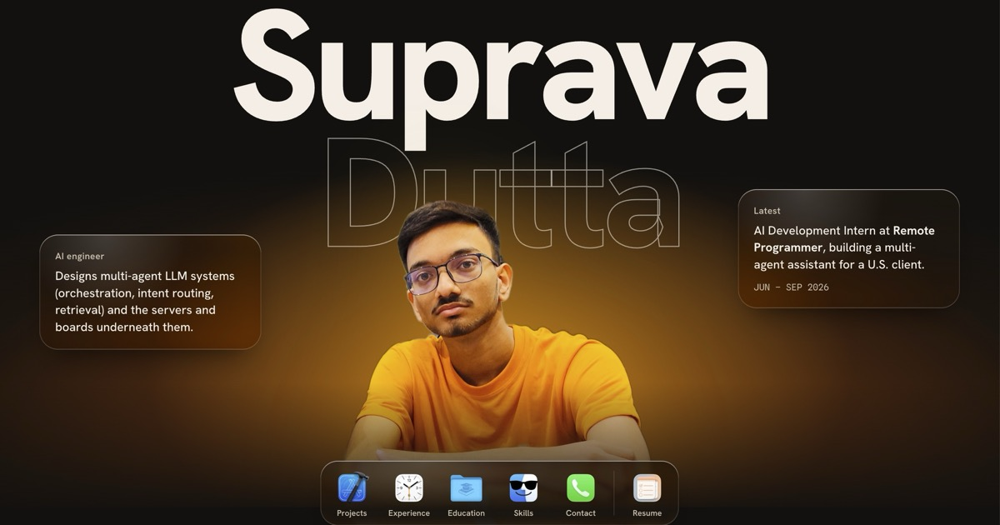

# Suprava Dutta

**Software engineer.** Designs multi-agent LLM systems (orchestration, intent routing, retrieval) and the servers and boards underneath them.

Latest: AI Development Intern at [Remote Programmer](https://remoteprogrammer.com/), building a multi-agent assistant for a U.S. client.

B.Tech in CSE at IEM Kolkata, alongside a BS in Electronics Systems Engineering at IIT Madras.

**Portfolio:** [sdacoder.github.io/myself](https://sdacoder.github.io/myself/) · **Resume:** [PDF](public/suprava-dutta-resume.pdf)

[GitHub](https://github.com/sDaCoder) · [LinkedIn](https://www.linkedin.com/in/suprava-dutta-sda-e23) · [LeetCode](https://leetcode.com/u/sda_e23/) · [Email](mailto:supravadutta.official23+portfolio@gmail.com)
